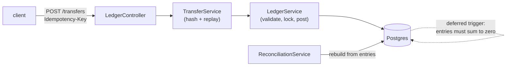

# ledger

[](https://github.com/hirashif/ledger/actions/workflows/ci.yml)

A **double-entry ledger service**: a REST API over Postgres where money can be moved but
never created or destroyed. Balanced entries enforced by the database, idempotent
transfers, row-level locking on balance checks, and a reconciliation job that rebuilds
every balance from history to catch the cache lying. Java 21, Spring Boot, plain SQL,
Flyway migrations, Testcontainers.

## Why I built this
I spent two years on payroll software, where being off by a cent is a real problem. I never
had to touch the accounting core underneath, and I wanted to actually understand it. Double
entry is 500 years old and every fintech company still runs on it.

It also turned out to be the fastest way to hit the problems that make money code hard.
Retries that must not double charge. Two withdrawals racing over one balance. A cached
number that quietly stops matching the history it came from. Each of those is a commit here,
and two of them I got wrong first.



## Data model
| table | holds |
|---|---|
| `accounts` | name, currency, `balance_minor` (a cache), `allows_overdraft` |
| `transactions` | one row per business event |
| `entries` | the movements. append-only, integer minor units, negative debits, positive credits |
| `idempotency_keys` | key → the transaction it produced, plus a hash of the request |

Two rules live in the database itself, not in application code:

```
ERROR:  transaction 7 does not balance: entries sum to -5000
ERROR:  entries are append-only: UPDATE is not allowed
```

## Run locally
Needs Java 21 and a Docker daemon (this repo uses [Colima](https://github.com/abiosoft/colima)).

```bash
make up      # postgres
make run     # flyway migrates, app listens on 8080
make test    # 34 tests, real postgres via testcontainers
make psql    # a shell on the database
make down
```

## API
| Method / path | Description |
|---|---|
| `POST /accounts` | create an account (`allowsOverdraft` marks funding accounts) |
| `GET /accounts/{id}` | account with its cached balance |
| `GET /accounts/{id}/entries` | entry history, newest first |
| `POST /transfers` | post a transfer. **requires an `Idempotency-Key` header** |
| `GET /reconciliation` | accounts whose cached balance disagrees with their entries |
| `GET /healthz` | liveness |

```bash
$ curl -s localhost:8080/accounts/2
{"id":2,"name":"alice","currency":"USD","balanceMinor":10000,"allowsOverdraft":false}

# the same request four times, money moves once
$ for i in 1 2 3 4; do curl -s -X POST localhost:8080/transfers \
    -H 'Idempotency-Key: pay-1' -H 'Content-Type: application/json' \
    -d '{"description":"alice pays bob 30","entries":[
         {"accountId":2,"amountMinor":-3000},{"accountId":3,"amountMinor":3000}]}'; done
{"transactionId":2}
{"transactionId":2}
{"transactionId":2}
{"transactionId":2}

$ curl -s localhost:8080/transfers -X POST -H 'Idempotency-Key: overdraw' ... # alice has $70
{"error":"account 2 has 7000 and cannot move -50000"}   # HTTP 422
```

## Design notes
The decisions worth explaining, and what they cost.

**Money is `BIGINT` minor units, never a float.** Cents, not dollars. Validation sums with
`Math.addExact` rather than `+=`, because `Long.MAX_VALUE + Long.MAX_VALUE + 2` wraps to
exactly zero and a naive running total would call that transaction balanced.

**No balance column as the source of truth.** A balance is the sum of an account's entries.
A single mutable number tells you what an account holds but never why, cannot be audited,
and cannot answer what the balance was last Tuesday.

**The zero-sum rule is a deferred constraint trigger.** Entries go in one at a time. A
per-statement check would reject a valid transfer the moment the first leg lands, since the
sum is briefly nonzero. `DEFERRABLE INITIALLY DEFERRED` moves the check to `COMMIT`, after
every entry is in. It raises with `ERRCODE = 'check_violation'` so the app sees a normal
integrity violation rather than an opaque `P0001` it cannot classify.

**Entries are append-only, enforced by trigger.** Corrections are reversing transactions, not
edits. The first thing this broke was the test suite's own cleanup, since `DELETE` trips the
trigger; tests `TRUNCATE` instead, which does not fire row-level triggers.

**Idempotency is a primary key, not a lookup.** There is deliberately no "has this key been
used" check before inserting: two retries arriving together would both see nothing and both
post. The insert is attempted and the primary key picks the winner, so the loser fails and
replays the original result. A stored request hash means the same key with a different body
is a `409` rather than a silently wrong success. The key is claimed **before** any business
rule runs, so a replay is answered as a replay even if its body would have been rejected.

**Solvency checks lock first, in id order.** Reading a balance and then writing is a lost
update: both transfers see $100, both approve $80, the account lands at -$60. Every debited
account is locked with `SELECT ... FOR UPDATE` before any balance is read, sorted by id so
two transfers over the same pair cannot deadlock. Pessimistic locking suits money better
than optimistic retries here, since a conflict means a real overdraft decision.

**Balances are cached, so reconciliation exists.** `accounts.balance_minor` is written in the
same transaction as the entries, so a read is one column instead of an O(n) sum. That leaves
two sources of truth, and they can drift. `GET /reconciliation` rebuilds every balance from
history and reports the mismatches. A test corrupts a cached balance on purpose to prove it
gets caught. `repair()` rewrites the cache from entries, but production should alert before
self-healing, since silent repair hides whatever caused the drift.

## Tests
34 tests, all against a real Postgres via Testcontainers. The two worth reading:

- `LostUpdateTest` drives **two connections by hand** instead of hoping threads collide.
  Twenty threads never reproduced the race across five runs; two hand-sequenced connections
  reproduce it every time, and the second test proves the row lock makes the loser wait.
- `LedgerApiTest.overdraftIsRejectedThroughTheApi` exists because it did not, once. The
  solvency check and locking were fully tested at the service layer while the HTTP path
  called the unchecked write method, so an account holding $70 could send $500 and get a
  `201`. Testing the layer is not testing the path.

## What I'd do next
- Multi-currency with FX, since an account's currency is stored but never enforced across a transaction's entries.
- Partition `entries` by month once it outgrows a single table, and keep reconciliation incremental instead of full-scan.
- An outbox table so other services can consume posted transactions without reading this database.
- Scheduled reconciliation with alerting, rather than an endpoint someone has to remember to call.

## Layout
```
src/main/java/com/hirashif/ledger/
  LedgerController.java     REST surface, ApiErrors maps exceptions to status codes
  TransferService.java      request hashing, replay on duplicate key
  LedgerService.java        validation, locking, solvency, posting
  ReconciliationService.java  drift detection and repair
src/main/resources/db/migration/   V1 schema and triggers, V2 idempotency, V3 overdraft, V4 cached balances
src/test/java/com/hirashif/ledger/ 34 tests
```
