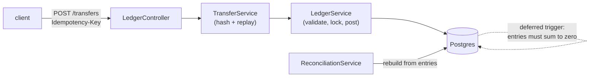

# ledger

[](https://github.com/hirashif/ledger/actions/workflows/ci.yml)

A **double-entry ledger service**: a REST API over Postgres where money can be moved but
never created or destroyed. Balanced entries enforced by the database, idempotent
transfers, row-level locking on balance checks, and a reconciliation job that rebuilds
every balance from history to catch the cache lying. Java 21, Spring Boot, plain SQL,
Flyway migrations, Testcontainers.

## Why I built this
I spent two years on payroll software, where being off by a cent is a real problem. I never
had to touch the accounting core underneath, and I wanted to actually understand it. Double
entry is 500 years old and every fintech company still runs on it.

It also turned out to be the fastest way to hit the problems that make money code hard.
Retries that must not double charge. Two withdrawals racing over one balance. A cached
number that quietly stops matching the history it came from. Each of those is a commit here,
and two of them I got wrong first.



## Data model
| table | holds |
|---|---|
| `accounts` | name, currency, `balance_minor` (a cache), `allows_overdraft` |
| `transactions` | one row per business event |
| `entries` | the movements. append-only, integer minor units, negative debits, positive credits |
| `idempotency_keys` | key → the transaction it produced, plus a hash of the request |

Two rules live in the database itself, not in application code:

```
ERROR:  transaction 7 does not balance: entries sum to -5000
ERROR:  entries are append-only: UPDATE is not allowed
```

## Run locally
Needs Java 21 and a Docker daemon (this repo uses [Colima](https://github.com/abiosoft/colima)).

```bash
make up      # postgres
make run     # flyway migrates, app listens on 8080
make test    # 34 tests, real postgres via testcontainers
make psql    # a shell on the database
make down
```

## API
| Method / path | Description |
|---|---|
| `POST /accounts` | create an account (`allowsOverdraft` marks funding accounts) |
| `GET /accounts/{id}` | account with its cached balance |
| `GET /accounts/{id}/entries` | entry history, newest first |
| `POST /transfers` | post a transfer. **requires an `Idempotency-Key` header** |
| `GET /reconciliation` | accounts whose cached balance disagrees with their entries |
| `GET /healthz` | liveness |

```bash
$ curl -s localhost:8080/accounts/2
{"id":2,"name":"alice","currency":"USD","balanceMinor":10000,"allowsOverdraft":false}

# the same request four times, money moves once
$ for i in 1 2 3 4; do curl -s -X POST localhost:8080/transfers \
    -H 'Idempotency-Key: pay-1' -H 'Content-Type: application/json' \
    -d '{"description":"alice pays bob 30","entries":[
         {"accountId":2,"amountMinor":-3000},{"accountId":3,"amountMinor":3000}]}'; done
{"transactionId":2}
{"transactionId":2}
{"transactionId":2}
{"transactionId":2}

$ curl -s localhost:8080/transfers -X POST -H 'Idempotency-Key: overdraw' ... # alice has $70
{"error":"account 2 has 7000 and cannot move -50000"}   # HTTP 422
```

## Design notes
A few decisions worth calling out.

**Amounts are `BIGINT` cents.** No floats anywhere near money. Validation sums with
`Math.addExact` instead of `+=`, which matters more than it sounds: `Long.MAX_VALUE +
Long.MAX_VALUE + 2` wraps around to exactly zero, so a plain running total would look at
that and call it balanced.

**Balances come from entries.** A mutable balance column gives you the number without any
record of how it got there, which falls apart the first time someone asks where their
money went.

**The zero-sum check is a deferred trigger.** Entries insert one at a time, so checking
after each row rejects a valid transfer the moment the first leg lands. `DEFERRABLE
INITIALLY DEFERRED` runs the check at `COMMIT` instead. It raises with
`ERRCODE = 'check_violation'`, so Spring maps it to a normal integrity violation instead of
the opaque `P0001` you get from a bare `RAISE`.

**Entries are append-only.** Mistakes get fixed by posting a reversing transaction. The
first thing this broke was my own test cleanup, since `DELETE` trips the trigger. Tests
`TRUNCATE` now.

**Idempotency leans on the primary key.** I don't check whether a key exists before
inserting it. Two retries landing together would both find nothing and both post. So the
insert just runs, the primary key sorts out who wins, and the loser replays the original
result. The stored request hash covers the other case: same key, different body, which is a
client bug and gets a 409. The key is claimed before any business rule runs, so a replay
stays a replay even when its body would have been rejected.

**Locks go before balance reads, ordered by account id.** Read-then-write on a balance is a
lost update. Both transfers see $100, both approve $80, the account ends at -$60. So every
debited account gets `SELECT ... FOR UPDATE` first, and the id ordering is what keeps two
transfers over the same pair from deadlocking. I went pessimistic instead of optimistic here
because a conflict is a real overdraft decision, not something worth retrying.

**The cached balance needs a reconciler.** `accounts.balance_minor` is written alongside the
entries, so a read is one column instead of summing all of history. That's two sources of
truth and they can drift. `GET /reconciliation` rebuilds everything from entries and reports
what disagrees. A test corrupts a balance on purpose to make sure that works. `repair()`
exists too, but production should alert before self-healing, since fixing it quietly hides
whatever broke it.

## Tests
34 tests, all against a real Postgres via Testcontainers. The two worth reading:

- `LostUpdateTest` drives **two connections by hand** instead of hoping threads collide.
  Twenty threads never reproduced the race across five runs; two hand-sequenced connections
  reproduce it every time, and the second test proves the row lock makes the loser wait.
- `LedgerApiTest.overdraftIsRejectedThroughTheApi` exists because it did not, once. The
  solvency check and locking were fully tested at the service layer while the HTTP path
  called the unchecked write method, so an account holding $70 could send $500 and get a
  `201`. Testing the layer is not testing the path.

## What I'd do next
- Multi-currency with FX, since an account's currency is stored but never enforced across a transaction's entries.
- Partition `entries` by month once it outgrows a single table, and keep reconciliation incremental instead of full-scan.
- An outbox table so other services can consume posted transactions without reading this database.
- Scheduled reconciliation with alerting, rather than an endpoint someone has to remember to call.

## Layout
```
src/main/java/com/hirashif/ledger/
  LedgerController.java     REST surface, ApiErrors maps exceptions to status codes
  TransferService.java      request hashing, replay on duplicate key
  LedgerService.java        validation, locking, solvency, posting
  ReconciliationService.java  drift detection and repair
src/main/resources/db/migration/   V1 schema and triggers, V2 idempotency, V3 overdraft, V4 cached balances
src/test/java/com/hirashif/ledger/ 34 tests
```
